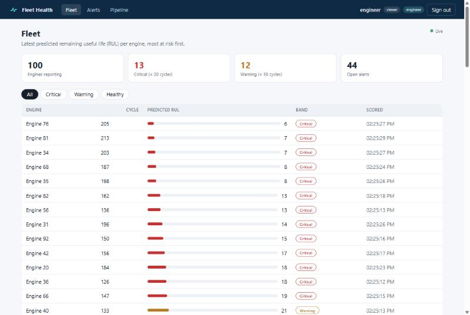
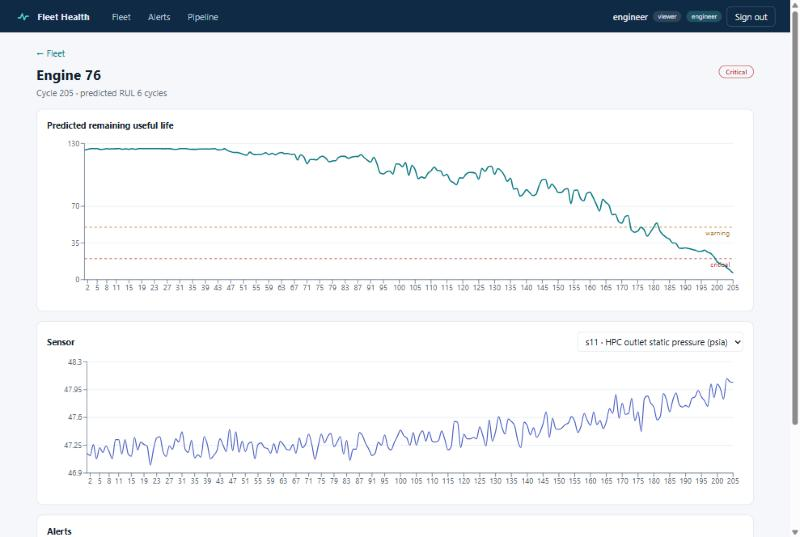
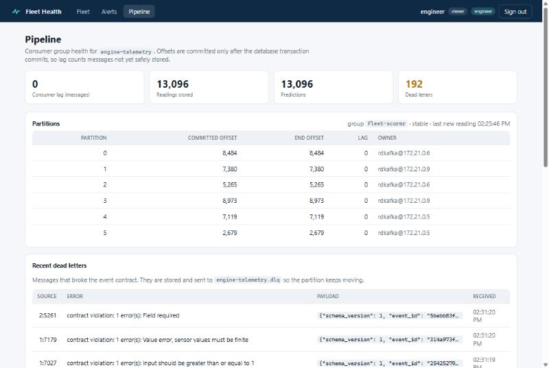
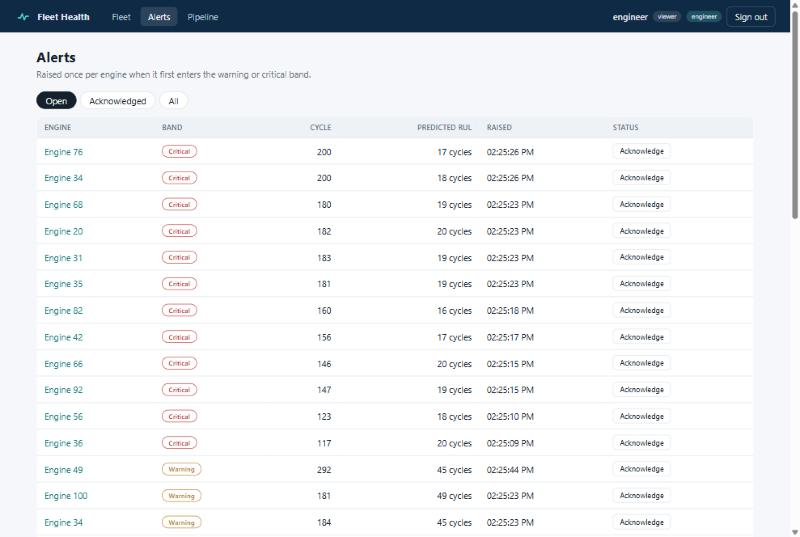
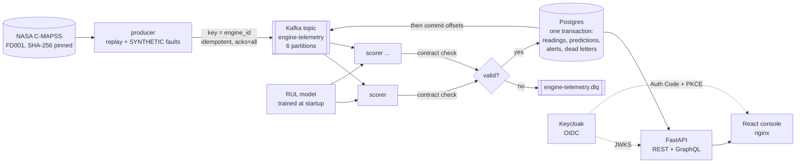

# Fleet Health Console

A real-time data product for a turbofan fleet. Engine telemetry streams through **Kafka**. A consumer group
validates it against a contract, stores it in **Postgres** and scores remaining useful life (RUL) with an ML model.
A **FastAPI** service exposes REST and **GraphQL** APIs. A **React + TypeScript** console shows the fleet, alerts and
pipeline health, behind **OIDC sign-in (Keycloak)** with role-based access.

The whole stack runs with one command in Docker Compose. CI covers lint, unit, API, contract and Postgres
integration tests, dependency audits and image scans.

> **Data:** the stream replays the public NASA C-MAPSS FD001 test engines, a *simulation* of turbofan degradation.
> A small share of messages is deliberately corrupted or duplicated (**SYNTHETIC** fault injection) so the
> dead-letter and deduplication paths run on every replay.

| Fleet: live RUL per engine, most at risk first | Engine: predicted RUL and sensor history |
|---|---|
|  |  |
| **Pipeline: per-partition offsets, lag, owners, dead letters** | **Alerts: acknowledging needs the `engineer` role** |
|  |  |

## Architecture



| Concern | How it is handled | Where |
|---|---|---|
| Ordering | Key = `engine_id`, so each engine's readings stay in order on one partition | `producer.py`, D-001 |
| Delivery guarantee | Manual offset commit *after* the DB transaction; natural-key upserts absorb redelivery (effectively-once) | `scorer.py`, D-002 |
| Rebalancing | Stateless consumers: rolling-window history is read back from Postgres, so any consumer can own any partition | `scorer.py`, D-003 |
| Poison messages | Contract violations go to a dead-letter table and topic; the partition keeps moving | `scorer.py`, D-004 |
| Schema evolution | JSON Schema contract committed in `contracts/`, test fails on drift, `schema_version` pinned | `schemas.py`, D-005 |
| Auth | OIDC Authorization Code + PKCE; API checks signature, expiry, issuer, audience and roles | `auth.py`, D-006 |
| Least privilege | `viewer` reads; only `engineer` can acknowledge alerts (403 otherwise) | `api.py` |
| Secrets | No secrets in code or config; connection strings from the environment; demo-only defaults | `.env.example` |
| Supply chain | Locked dependencies (`uv.lock`, `package-lock.json`), `pip-audit`, `npm audit`, Trivy image scans, Dependabot | `.github/` |
| Runtime hardening | Non-root containers, CSP and security headers in nginx, same-origin API (no CORS) | `docker/`, `web/nginx.conf` |

## Run it

Prerequisites: Docker Desktop.

```bash
docker compose up --build
```

Then open **http://localhost:3000** and sign in with one of the demo users defined in
[`infra/keycloak/fleet-realm.json`](infra/keycloak/fleet-realm.json): `viewer` (read-only) or `engineer` (can
acknowledge alerts). These are local demo credentials only.

The `init` service downloads and verifies the NASA archive, trains the model, creates the schema and topics; the
producer then replays about 300 cycles at 5 cycles a second.

| | |
|---|---|
| Console | http://localhost:3000 |
| API docs (OpenAPI) | http://localhost:8000/docs |
| GraphQL | `POST http://localhost:8000/graphql` (bearer token required) |
| Keycloak | http://localhost:8080 |

Useful commands:

```bash
docker compose up -d --scale scorer=3      # three consumers share the six partitions; see the Pipeline page
```

```bash
docker compose run --rm --no-deps producer  # replay again: every write is an upsert, so nothing duplicates
```

## Develop and test

```bash
uv sync
```

```bash
uv run pytest
```

```bash
cd web && npm ci && npm test && npm run dev
```

Postgres integration tests run when `FLEET_TEST_DATABASE_URL` points at an empty database (CI sets this up).

| Test file | What it proves |
|---|---|
| `tests/test_scorer_db.py` | A redelivered batch leaves the database unchanged; cycle-by-cycle scoring equals one big batch; one alert per engine per band |
| `tests/test_contract.py` | The committed JSON Schema matches the code; every kind of injected fault is rejected; replay keeps per-engine order |
| `tests/test_auth_api.py` | Tokens with a wrong signature, issuer, audience or expiry are rejected; viewers get 403 on writes; GraphQL needs auth |
| `tests/test_features_model.py` | No look-ahead leakage; online features equal offline features; predictions bounded |
| `web/src/test/` | Role-gated Acknowledge button, alert links, token role parsing |

## Results from a local run

Measured on the Docker Compose stack (8 November 2026). Re-run with the commands above.

| Check | Result |
|---|---|
| Messages replayed | 13,300 per replay (13,096 NASA readings plus SYNTHETIC duplicates and corrupt copies), 0 delivery failures |
| Readings and predictions stored | 13,096 each: exactly the rows in `test_FD001.txt`, so every injected duplicate was absorbed |
| Dead letters | 64 per replay, one per corrupted message, all with the reason recorded |
| Three full replays, then scaled to 3 scorers | Still 13,096 readings and 45 alerts; group `STABLE`; 2 partitions per consumer; lag 0 |
| Live vs batch scoring | Identical predictions for all 847 rows in the integration test (see D-010 for the bug this test caught) |
| Auth | No token: 401. Viewer acknowledging an alert: 403. Engineer: 200, recorded with their username |
| RUL model (FD001 test set, last cycle per engine) | RMSE 19.9 cycles vs 40.1 for predicting the mean; 100 engines |
| Fleet at the end of the replay | 100 engines: 13 critical, 12 warning; 45 alerts raised |

Two bugs found while building it, both documented with fixes: training/serving skew from running-sum rolling
features (D-010), and a consumer crash when a rebalance invalidated an in-flight commit (D-011).

## Repository layout

```
src/fleet/        producer, scorer (consumer), API, GraphQL, auth, model, features, contract
web/              React + TypeScript console (Vite, TanStack Query, Recharts, react-oidc-context)
db/schema.sql     tables and natural keys
contracts/        telemetry event JSON Schema
infra/keycloak/   realm, client and demo users
configs/          topics, model settings, risk bands, replay and fault-injection rates
docs/decisions.md every judgement call (D-001 ...)
```

## Limitations

- One Kafka broker and plain-text listeners: fine locally, not for production (use TLS/SASL and replication 3).
- Tokens live in browser session storage. A backend-for-frontend with HTTP-only cookies would be stronger (D-006).
- The model is intentionally simple (D-007); see
  [cmapss-predictive-maintenance](https://github.com/Max-Isse/cmapss-predictive-maintenance) for the modelling work.
- Risk-band thresholds are assumptions, not estimates (D-009).
